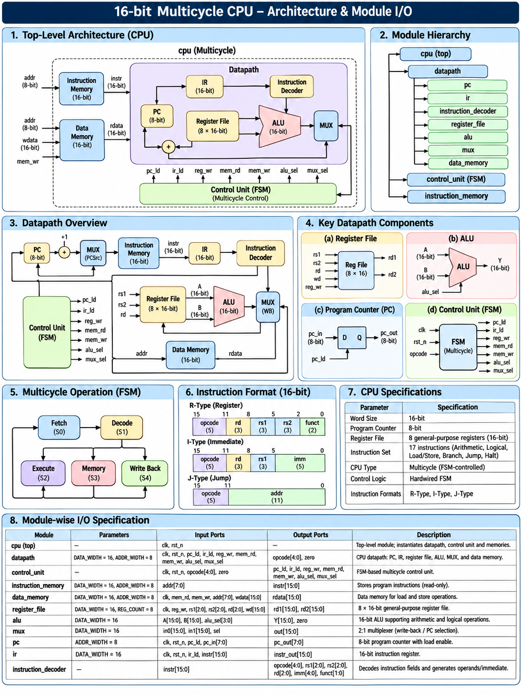
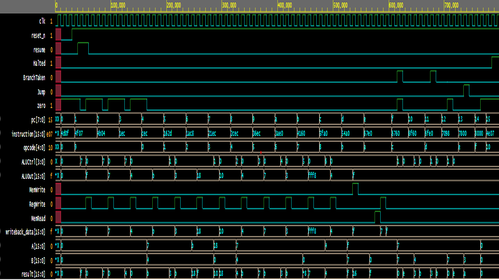

# 16-bit Multicycle CPU with UVM Verification

A 16-bit multicycle CPU designed in Verilog HDL and verified using SystemVerilog, Universal Verification Methodology (UVM), functional coverage and SystemVerilog Assertions (SVA).

The project focuses on both RTL design and verification methodology, implementing a structured UVM testbench with directed and constrained-random testing, a reference scoreboard, functional coverage models and assertion-based checks.

---

## Project Overview

| Parameter                 | Description                           |
| ------------------------- | ------------------------------------- |
| Processor                 | 16-bit Multicycle CPU                 |
| RTL Language              | Verilog HDL                           |
| Verification Language     | SystemVerilog                         |
| Verification Methodology  | UVM 1.2                               |
| Simulator                 | Cadence Xcelium 25.03                 |
| Instruction Width         | 16 bits                               |
| Data Width                | 16 bits                               |
| Program Counter           | 8 bits                                |
| General-Purpose Registers | 8 (R0–R7)                             |
| Data Memory               | 256 × 16 bits                         |
| Instruction Memory        | 256 × 16 bits (intended architecture) |
| Instruction Set           | 17 instructions                       |

## CPU Architecture

The processor follows a multicycle execution approach, with operations controlled by a finite state machine.\



The CPU consists of the following major components:

- Control Unit
- Arithmetic Logic Unit (ALU)
- Register File
- Program Counter (PC)
- Next PC Logic
- Instruction Memory
- Instruction Register (IR)
- Instruction Decoder
- Immediate Generator
- A and B Registers
- ALU Output Register
- Data Memory
- Memory Data Register (MDR)
- Writeback Multiplexer

### Instruction Set Architecture

The processor supports 17 instructions:

| Opcode | Instruction | Description                |
| ------ | ----------- | -------------------------- |
| 00000  | ADD         | Register addition          |
| 00001  | SUB         | Register subtraction       |
| 00010  | ADDI        | Addition with immediate    |
| 00011  | SUBI        | Subtraction with immediate |
| 00100  | AND         | Bitwise AND                |
| 00101  | OR          | Bitwise OR                 |
| 00110  | XOR         | Bitwise XOR                |
| 00111  | NOT         | Bitwise NOT                |
| 01000  | MOV         | Register transfer          |
| 01001  | LI          | Load immediate             |
| 01010  | LD          | Load from data memory      |
| 01011  | ST          | Store to data memory       |
| 01100  | BEQ         | Branch if equal            |
| 01101  | BNE         | Branch if not equal        |
| 01110  | JMP         | Unconditional jump         |
| 01111  | NOP         | No operation               |
| 10000  | HALT        | Halt execution             |

### Instruction Format

The 16-bit instruction uses the following general field allocation:

| Field                     | Bits    |
| ------------------------- | ------- |
| Opcode                    | [15:11] |
| Destination register (rd) | [10:8]  |
| Source register 1 (rs1)   | [7:5]   |
| Source register 2 (rs2)   | [4:2]   |
| Immediate / Offset        | [4:0]   |

The interpretation of the lower instruction fields depends on the instruction type.

---

## UVM Verification Architecture

A modular UVM testbench was developed to verify the CPU independently of its RTL implementation.

The verification environment consists of:

- **Transaction:** Represents reset and resume control transactions.
- **Sequence:** Generates directed control transactions.
- **Random Sequence:** Generates constrained-random instruction programs.
- **Sequencer:** Supplies transactions to the driver.
- **Driver:** Applies reset and resume signals to the DUT.
- **Monitor:** Observes DUT activity.
- **Agent:** Groups the verification components.
- **Environment:** Instantiates and connects the agent and scoreboard.
- **Scoreboard:** Maintains a reference model and checks CPU execution results.
- **Test:** Controls the verification execution.

### Verification Methodology

Two major testing approaches were implemented.

#### 1. Directed Testing

A predefined program exercises the supported instruction set and checks CPU execution using the scoreboard.

#### 2. Constrained-Random Testing

A randomized instruction program is generated with varying register assignments and immediate values.

The generated program includes:

- Arithmetic and logical operations
- Register transfers and immediate loading
- Memory read and write operations
- Taken and not-taken BEQ branches
- Taken and not-taken BNE branches
- Jump and NOP instructions
- HALT operation

Instruction ordering is deliberately structured to maintain valid dependencies and predictable program execution.

### Scoreboard

The reference scoreboard checks:

- Register write results
- Program counter progression
- Branch and jump behaviour
- Data memory operations
- HALT behaviour

---

## Functional Coverage

Functional coverage was implemented using SystemVerilog covergroups and coverpoints.

The coverage model includes:

- Instruction opcode coverage
- Branch opcode and outcome coverage
- Destination register coverage
- Source register coverage
- Branch source register coverage
- Memory read and write address coverage
- ALU control coverage
- Immediate opcode and value coverage
- Writeback data distribution
- Register source cross coverage
- Opcode and destination register cross coverage
- Memory operation and address cross coverage

The coverage model helps identify untested instruction combinations and functional scenarios.

---

## SystemVerilog Assertions (SVA)

Assertion-based verification was implemented using separate checker modules and `bind` statements.

The assertion checkers cover the following components:

| Component          | Assertions                                                 |
| ------------------ | ---------------------------------------------------------- |
| Program Counter    | Reset, update and hold behaviour                           |
| Control Unit       | State legality and control signal consistency              |
| Register File      | R0 protection, read behaviour, write correctness and reset |
| ALU                | Arithmetic, logical, pass-through operations and zero flag |
| Data Memory        | Read, write, read/write exclusivity and read disable       |
| Instruction Memory | Instruction fetch consistency                              |

The checkers are integrated with the DUT using SystemVerilog `bind` constructs, keeping the original RTL separate from the assertion implementation.

---

## Simulation and Verification Results

The verification environment was simulated using Cadence Xcelium 25.03 with UVM 1.2.

### Simulation Waveform



### Verification Summary

| Verification Stage           | Status |
| ---------------------------- | ------ |
| Directed UVM Test            | PASS   |
| Constrained-Random UVM Test  | PASS   |
| Multiple Random Seeds        | PASS   |
| Scoreboard Checks            | PASS   |
| Functional Coverage Sampling | PASS   |
| SVA Assertions               | PASS   |
| UVM Errors                   | 0      |
| UVM Warnings                 | 0      |
| UVM Fatals                   | 0      |

### Representative Random Test Results

A representative randomized simulation exercised:

- All 17 supported opcodes.
- Both taken and not-taken outcomes for BEQ.
- Both taken and not-taken outcomes for BNE.
- Register arithmetic and logical operations.
- Data memory read and write operations.
- Successful CPU termination through HALT.

The functional coverage model reported 100% opcode coverage and 100% branch opcode × outcome cross coverage in this run. Other coverage crosses remained partially covered.

---

## Tools and Technologies

- Verilog HDL
- SystemVerilog
- Universal Verification Methodology (UVM 1.2)
- SystemVerilog Assertions
- Cadence Xcelium 25.03
- EDA Playground
- Git and GitHub

---

## Repository Structure

```text
Simple-CPU-UVM-Verification/
│
├── rtl/
│   ├── cpu.v
│   ├── alu.v
│   ├── control_unit.v
│   ├── register_file.v
│   ├── data_memory.v
│   ├── instruction_memory.v
│   └── ...
│
├── verification/
│   ├── testbench.sv
│   │
│   ├── uvm/
│   │   ├── cpu_uvm_pkg.sv
│   │   ├── cpu_transaction.sv
│   │   ├── cpu_driver.sv
│   │   ├── cpu_sequencer.sv
│   │   ├── cpu_monitor.sv
│   │   ├── cpu_agent.sv
│   │   ├── cpu_env.sv
│   │   ├── cpu_scoreboard.sv
│   │   ├── cpu_sequence.sv
│   │   ├── cpu_random_sequence.sv
│   │   ├── cpu_test.sv
│   │   └── cpu_random_test.sv
│   │
│   ├── assertions/
│   │   └── cpu_assertions.sv
│   │
│   └── coverage/
│       └── cpu_coverage.sv
│
├── programs/
│   └── program.mem
│
├── .gitignore
└── README.md
```

*The structure is representative; filenames should match the actual repository contents.*

---

## Future Improvements

- Expand functional coverage across register and instruction combinations.
- Improve random instruction generation and scenario diversity.
- Add additional assertion properties for control and datapath behaviour.
- Automate multi-seed regression testing.
- Add architecture diagrams, waveforms and detailed simulation reports.

---

